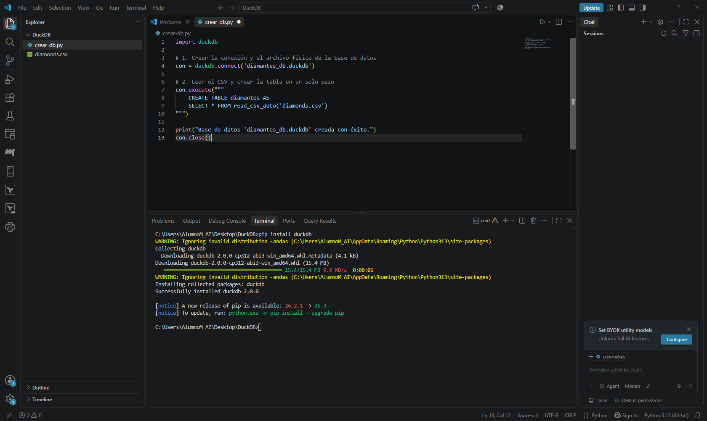
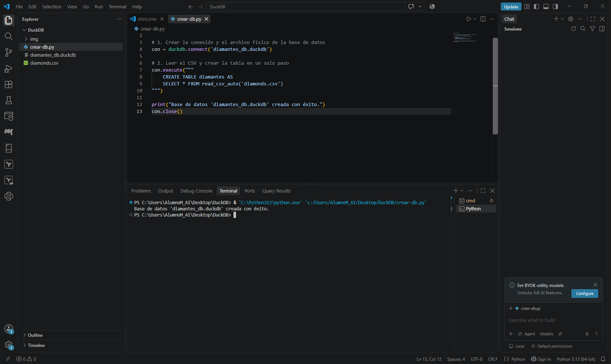
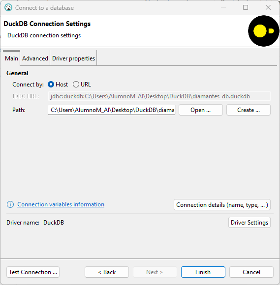
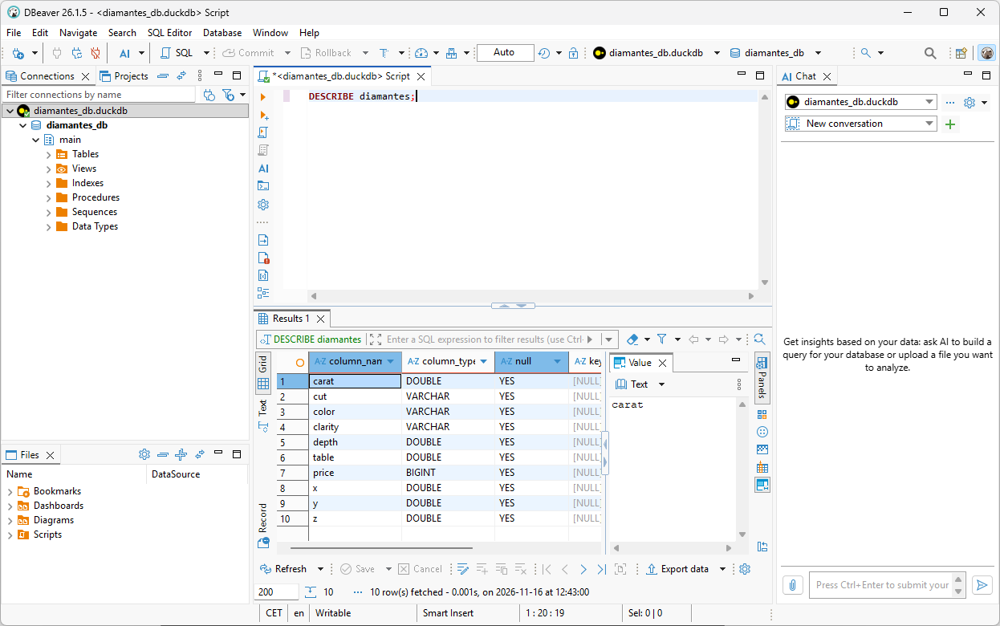
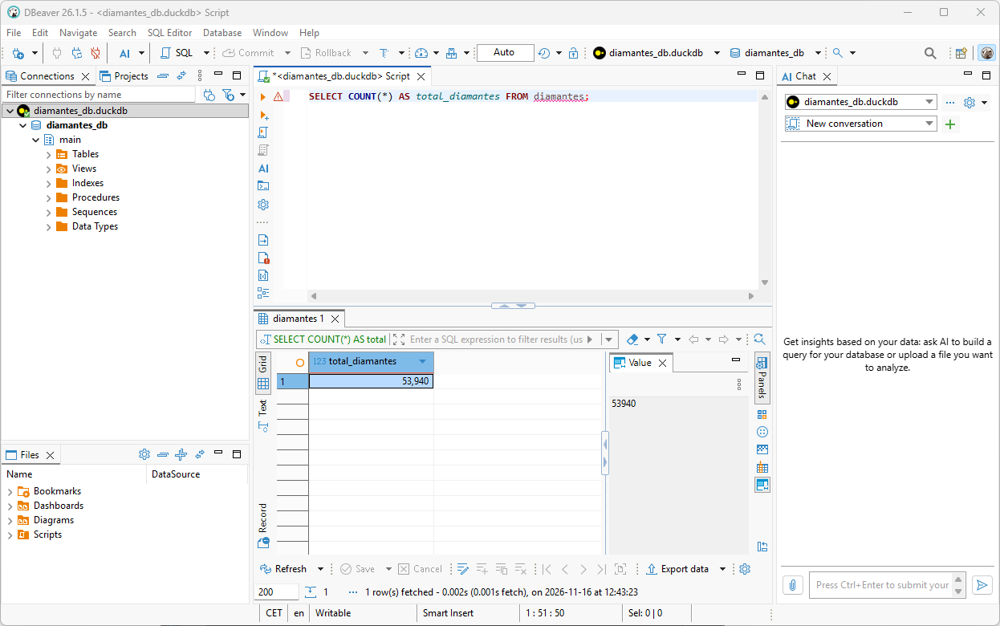
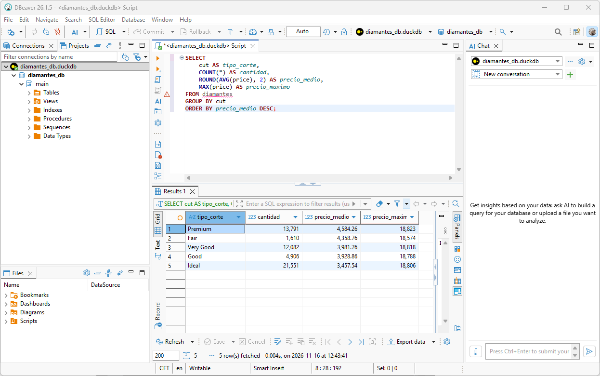
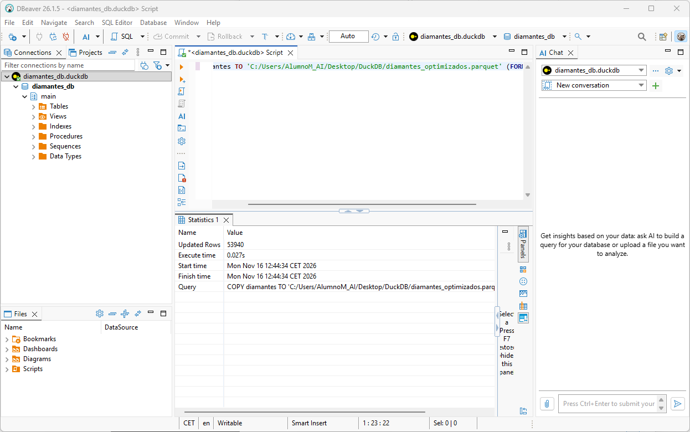
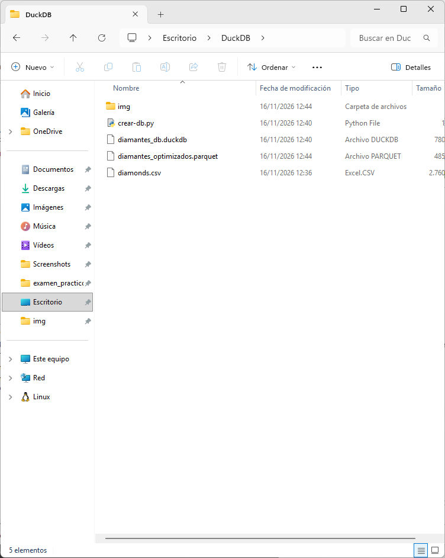

# Mini-práctica DuckDB

Creación de una base de datos DuckDB a partir de un CSV, consulta desde DBeaver y exportación a Parquet.

## Archivos

| Archivo | Descripción |
|---|---|
| `diamonds.csv` | Dataset original (53.940 diamantes) |
| `crear-db.py` | Script Python que crea la BD a partir del CSV |
| `diamantes_db.duckdb` | Base de datos DuckDB generada |
| `diamantes_optimizados.parquet` | Tabla exportada a formato Parquet |
| `img/` | Capturas del proceso |

## Pasos

### 1. Instalar DuckDB y preparar el script
```
pip install duckdb
```
El script `crear-db.py` conecta con (y crea) el fichero `diamantes_db.duckdb` y carga el CSV en una tabla con `read_csv_auto`, que infiere los tipos automáticamente:

```python
import duckdb
con = duckdb.connect('diamantes_db.duckdb')
con.execute("""
    CREATE TABLE diamantes AS
    SELECT * FROM read_csv_auto('diamonds.csv')
""")
con.close()
```


### 2. Ejecutar el script
Genera `diamantes_db.duckdb`.



### 3. Conectar desde DBeaver
Nueva conexión **DuckDB**, apuntando en *Path* al fichero `.duckdb`.



### 4. Consultas

**Estructura de la tabla** (tipos inferidos: `DOUBLE`, `VARCHAR`, `BIGINT`):
```sql
DESCRIBE diamantes;
```


**Total de registros** (53.940):
```sql
SELECT COUNT(*) AS total_diamantes FROM diamantes;
```


**Agregación por tipo de corte** (el corte *Premium* tiene el precio medio más alto, 4.584,26):
```sql
SELECT
    cut AS tipo_corte,
    COUNT(*) AS cantidad,
    ROUND(AVG(price), 2) AS precio_medio,
    MAX(price) AS precio_maximo
FROM diamantes
GROUP BY cut
ORDER BY precio_medio DESC;
```


### 5. Exportar a Parquet
```sql
COPY diamantes TO 'diamantes_optimizados.parquet' (FORMAT PARQUET);
```
Se exportan 53.940 filas en ~0,03 s.



### 6. Resultado
El Parquet (~485 KB) ocupa mucho menos que el CSV original (~2,7 MB) gracias a su almacenamiento columnar comprimido.


